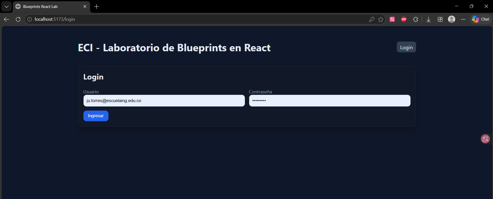
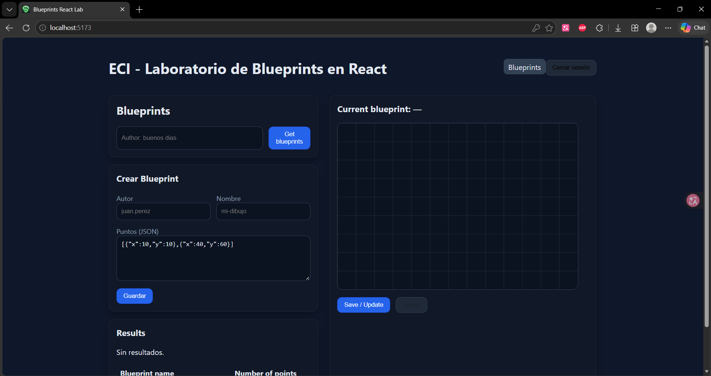
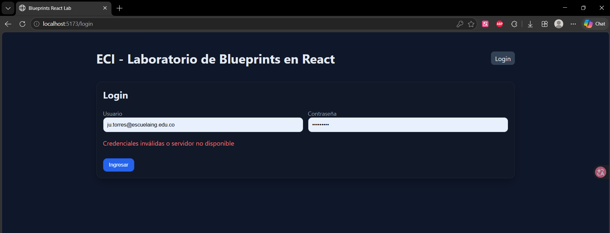
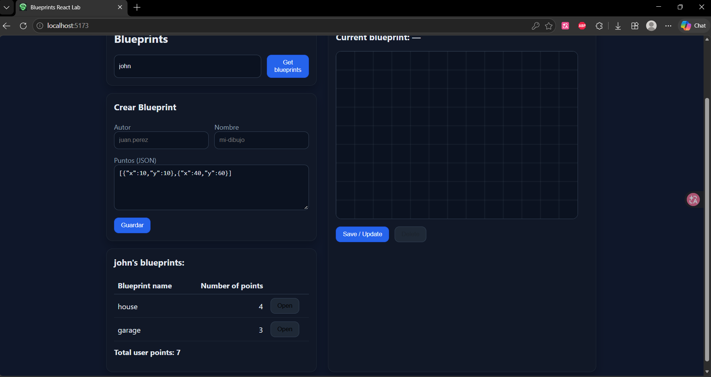
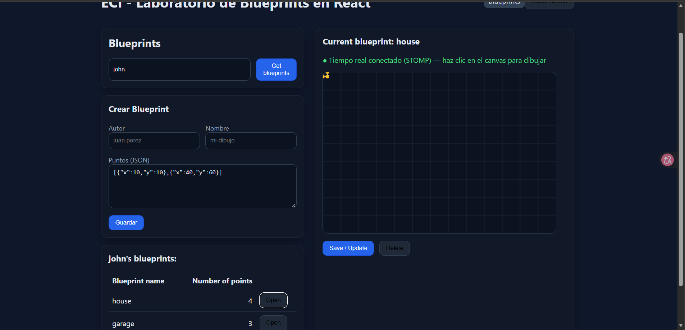
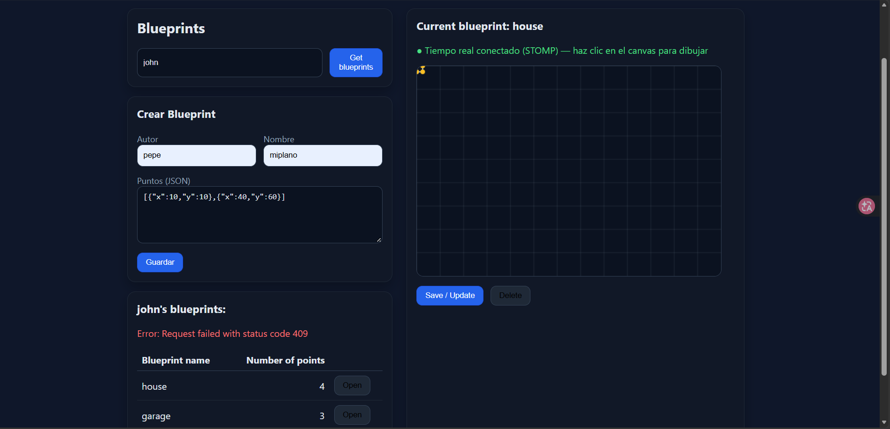
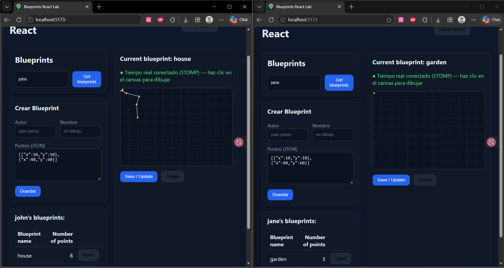
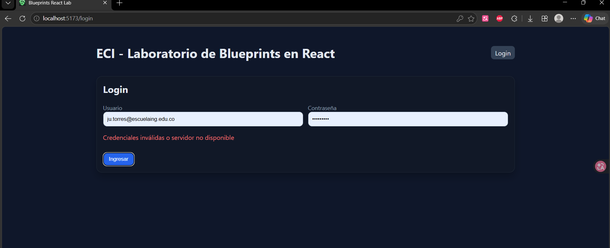

# Solucion Lab 06  — BluePrints en Tiempo Real (Sockets & STOMP)

**Integrantes:** Juan Camilo Torres Suarez · Valeria Bermudez Aguilar

Esta guía explica cómo levantar el proyecto y las evidencias, paso a paso, para verificar cada requisito del laboratorio.

---

## 0. Qué hay en el repositorio

```
ARSWLAB06/
├── ARSW_LAB04/   → Backend: Spring Boot 3 + Java 21 (REST CRUD + JWT + WebSocket/STOMP)  · puerto 8080
└── ARSWLAB05/    → Frontend: React + Vite + Redux (login, CRUD, canvas en tiempo real)   · puerto 5173
                    (aquí está el docker-compose.yml que levanta los dos)
```

```
Navegador (localhost:5173)
 ├─ HTTP REST  (login + CRUD, con header Authorization: Bearer <token>) ──> Spring Boot :8080 /api/...
 └─ WebSocket STOMP  ws://localhost:8080/ws-blueprints
       ├─ publica  /app/draw                        (cada clic en el canvas)
       └─ escucha  /topic/blueprints.{autor}.{plano} (el servidor guarda el punto y reenvía el plano)
```

---

## 1. Requisitos

- **Docker Desktop** abierto y con el motor corriendo (*Engine running*).
- Los puertos **8080** y **5173** libres (no tener otro backend o `npm run dev` corriendo).

---

## 2. Cómo correr el proyecto

Desde la raíz del repositorio:

```bash
cd ARSWLAB05
docker compose up --build
```

- La primera vez tarda unos minutos (Maven descarga dependencias dentro del contenedor).
- Está listo cuando en los logs aparece: `Started BlueprintsApiApplication`.
- Se crean **dos contenedores**: `backend` (8080) y `web` (5173).

Abrir en el navegador: **http://localhost:5173**

Para detenerlo: `Ctrl + C` y luego:

```bash
docker compose down
```

<details>
<summary>Alternativa sin Docker (local)</summary>

Terminal 1 — backend (requiere JDK 21 y Maven):

```bash
cd ARSW_LAB04
mvn spring-boot:run
```

Terminal 2 — frontend (requiere Node 18+):

```bash
cd ARSWLAB05
npm install
npm run dev
```

</details>

---

## 3. Usuarios de prueba


| Usuario     | Contraseña    | Permisos                                            |
| ------------- | ---------------- | ----------------------------------------------------- |
| `assistant` | `assistant123` | Leer y escribir (crear, dibujar, guardar, eliminar) |
| `student`   | `student123`   | Solo lectura                                        |


## 4. Casos de prueba
    mas en /resources/images

###  CP-01 · La app pide iniciar sesión

1. Abrir `http://localhost:5173`.

**Evidencia:**


###  CP-02 · Login correcto

1. Ingresar `assistant` / `assistant123` → **Ingresar**.

**Esperado:** entra a la página de Blueprints; el menú muestra **Blueprints** y **Cerrar sesión**.
En Network: `POST /api/auth/login` → **200** con `access_token`.



### CP-03 · Login incorrecto

1. Cerrar sesión e ingresar `assistant` / `clave-mala`.

**Esperado:** mensaje rojo *"Credenciales inválidas o servidor no disponible"*. Network: **401**.



###  CP-04 · Listar planos de un autor

1. Con sesión de `assistant`, escribir `john` → **Get blueprints**.

**Esperado:** tabla con `house` (4 puntos) y `garage` (3 puntos) y **Total user points: 7**.
Network: `GET /api/blueprints/john` → **200** con header `Authorization: Bearer ...`.



###  CP-05 · Abrir un plano

1. Clic en **Open** de `house`.

**Esperado:** título *"Current blueprint: house"*, el canvas dibuja el plano y aparece en verde
**"● Tiempo real conectado (STOMP)"**. Network: `GET /api/blueprints/john/house` → **200**.




###  CP-06 · Crear un plano (CRUD – Create)

1. En **Crear Blueprint**: Autor `pepe`, Nombre `miplano`, Puntos:
2. **Guardar**. Luego buscar `pepe` → **Open** en `miplano`.


**Esperado:** `POST /api/blueprints` → **201**; el plano aparece en la tabla y el canvas dibuja una casa.

###  CP-07 · Crear un plano repetido

1. Repetir CP-06 con el mismo autor y nombre.

**Esperado:** `POST` → **409** y mensaje de error en rojo. No se duplica.



###  CP-08 · Colaboración en tiempo real (requisito principal)

1. Abrir **dos pestañas** en `http://localhost:5173` (en ambas, sesión de `assistant`).
2. En las dos: buscar `juan` → **Open** en `mi-casa` (o `john` → `house`).
3. Hacer **clic en el canvas** de la pestaña 1.
4. Hacer clic en el canvas de la pestaña 2.

**Esperado:**

- Cada punto aparece **inmediatamente en ambas pestañas** (sin recargar).
- La columna *Number of points* y el *Total user points* se actualizan solos en las dos.
- Los puntos quedan **guardados en el backend**: al recargar (F5) y volver a abrir el plano siguen ahí.
- En los logs del backend aparece una línea por punto, por ejemplo:
  `draw Point[x=250, y=180] -> /topic/blueprints.juan.mi-casa (7 puntos)`

  

###  CP-09 · Aislamiento por plano

1. Pestaña 1 con `john/house` abierto, pestaña 2 con `juan/mi-casa` abierto.
2. Dibujar en la pestaña 1.

**Esperado:** la pestaña 2 **no** recibe esos puntos (cada plano tiene su propio tópico).



###  CP-13 · Seguridad del API

1. Sin iniciar sesión, abrir en el navegador `http://localhost:8080/api/blueprints`.

**Esperado:** **401 Unauthorized** (el API exige token JWT).
La documentación pública está en `http://localhost:8080/swagger-ui/index.html`.




Datos que ya vienen cargados: autor **`john`** (planos `house` y `garage`) y autora **`jane`** (plano `garden`).

> **Repositorio:** `DECSIS-ECI/Lab_P4_BluePrints_RealTime-Sokets`**Front:** React + Vite (Canvas, CRUD, y selector de tecnología RT)**Backends guía (elige uno o compáralos):**
>
> - **Socket.IO (Node.js):** https://github.com/DECSIS-ECI/example-backend-socketio-node-/blob/main/README.md
> - **STOMP (Spring Boot):** https://github.com/DECSIS-ECI/example-backend-stopm/tree/main

## 🎯 Objetivo del laboratorio

Implementar **colaboración en tiempo real** para el caso de BluePrints. El Front consume la API CRUD de la Parte 3 (o equivalente) y habilita tiempo real usando **Socket.IO** o **STOMP**, para que múltiples clientes dibujen el mismo plano de forma simultánea.

Al finalizar, el equipo debe:

1. Integrar el Front con su **API CRUD** (listar/crear/actualizar/eliminar planos, y total de puntos por autor).
2. Conectar el Front a un backend de **tiempo real** (Socket.IO **o** STOMP) siguiendo los repos guía.
3. Demostrar **colaboración en vivo** (dos pestañas navegando el mismo plano).

---

## 🧩 Alcance y criterios funcionales

- **CRUD** (REST):
  - `GET /api/blueprints?author=:author` → lista por autor (incluye total de puntos).
  - `GET /api/blueprints/:author/:name` → puntos del plano.
  - `POST /api/blueprints` → crear.
  - `PUT /api/blueprints/:author/:name` → actualizar.
  - `DELETE /api/blueprints/:author/:name` → eliminar.
- **Tiempo real (RT)** (elige uno):
  - **Socket.IO** (rooms): `join-room`, `draw-event` → broadcast `blueprint-update`.
  - **STOMP** (topics): `@MessageMapping("/draw")` → `convertAndSend(/topic/blueprints.{author}.{name})`.
- **UI**:
  - Canvas con **dibujo por clic** (incremental).
  - Panel del autor: **tabla** de planos y **total de puntos** (`reduce`).
  - Barra de acciones: **Create / Save/Update / Delete** y **selector de tecnología** (None / Socket.IO / STOMP).
- **DX/Calidad**: código limpio, manejo de errores, README de equipo.

---

## 🏗️ Arquitectura (visión rápida)

```
React (Vite)
 ├─ HTTP (REST CRUD + estado inicial) ───────────────> Tu API (P3 / propia)
 └─ Tiempo Real (elige uno):
     ├─ Socket.IO: join-room / draw-event ──────────> Socket.IO Server (Node)
     └─ STOMP: /app/draw -> /topic/blueprints.* ────> Spring WebSocket/STOMP
```

**Convenciones recomendadas**

- **Plano como canal/sala**: `blueprints.{author}.{name}`
- **Payload de punto**: `{ x, y }`

---

## 📦 Repos guía (clona/consulta)

- **Socket.IO (Node.js)**: https://github.com/DECSIS-ECI/example-backend-socketio-node-/blob/main/README.md
  - *Uso típico en el cliente:* `io(VITE_IO_BASE, { transports: ['websocket'] })`, `join-room`, `draw-event`, `blueprint-update`.
- **STOMP (Spring Boot)**: https://github.com/DECSIS-ECI/example-backend-stopm/tree/main
  - *Uso típico en el cliente:* `@stomp/stompjs` → `client.publish('/app/draw', body)`; suscripción a `/topic/blueprints.{author}.{name}`.

---

## ⚙️ Variables de entorno (Front)

Crea `.env.local` en la raíz del proyecto **Front**:

```bash
# REST (tu backend CRUD)
VITE_API_BASE=http://localhost:8080

# Tiempo real: apunta a uno u otro según el backend que uses
VITE_IO_BASE=http://localhost:3001     # si usas Socket.IO (Node)
VITE_STOMP_BASE=http://localhost:8080  # si usas STOMP (Spring)
```

En la UI, selecciona la tecnología en el **selector RT**.

---

## 🚀 Puesta en marcha

### 1) Backend RT (elige uno)

**Opción A — Socket.IO (Node.js)**
Sigue el README del repo guía:
https://github.com/DECSIS-ECI/example-backend-socketio-node-/blob/main/README.md

```bash
npm i
npm run dev
# expone: http://localhost:3001
# prueba rápida del estado inicial:
curl http://localhost:3001/api/blueprints/juan/plano-1
```

**Opción B — STOMP (Spring Boot)**
Sigue el repo guía:
https://github.com/DECSIS-ECI/example-backend-stopm/tree/main

```bash
./mvnw spring-boot:run
# expone: http://localhost:8080
# endpoint WS (ej.): /ws-blueprints
```

### 2) Front (este repo)

```bash
npm i
npm run dev
# http://localhost:5173
```

En la interfaz: selecciona **Socket.IO** o **STOMP**, define `author` y `name`, abre **dos pestañas** y dibuja en el canvas (clics).

---

## 🔌 Protocolos de Tiempo Real (detalle mínimo)

### A) Socket.IO

- **Unirse a sala**
  ```js
  socket.emit('join-room', `blueprints.${author}.${name}`)
  ```
- **Enviar punto**
  ```js
  socket.emit('draw-event', { room, author, name, point: { x, y } })
  ```
- **Recibir actualización**
  ```js
  socket.on('blueprint-update', (upd) => { /* append points y repintar */ })
  ```

### B) STOMP

- **Publicar punto**
  ```js
  client.publish({ destination: '/app/draw', body: JSON.stringify({ author, name, point }) })
  ```
- **Suscribirse a tópico**
  ```js
  client.subscribe(`/topic/blueprints.${author}.${name}`, (msg) => { /* append points y repintar */ })
  ```

---

## 🧪 Casos de prueba mínimos

- **Estado inicial**: al seleccionar plano, el canvas carga puntos (`GET /api/blueprints/:author/:name`).
- **Dibujo local**: clic en canvas agrega puntos y redibuja.
- **RT multi-pestaña**: con 2 pestañas, los puntos se **replican** casi en tiempo real.
- **CRUD**: Create/Save/Delete funcionan y refrescan la lista y el **Total** del autor.

---

## 📊 Entregables del equipo

1. Código del Front integrado con **CRUD** y **RT** (Socket.IO o STOMP).
2. **Video corto** (≤ 90s) mostrando colaboración en vivo y operaciones CRUD.
3. **README del equipo**: setup, endpoints usados, decisiones (rooms/tópicos), y (opcional) breve comparativa Socket.IO vs STOMP.

---

## 🧮 Rúbrica sugerida

- **Funcionalidad (40%)**: RT estable (join/broadcast), aislamiento por plano, CRUD operativo.
- **Calidad técnica (30%)**: estructura limpia, manejo de errores, documentación clara.
- **Observabilidad/DX (15%)**: logs útiles (conexión, eventos), health checks básicos.
- **Análisis (15%)**: hallazgos (latencia/reconexión) y, si aplica, pros/cons Socket.IO vs STOMP.

---

## 🩺 Troubleshooting

- **Pantalla en blanco (Front)**: revisa consola; confirma `@vitejs/plugin-react` instalado y que `AppP4.jsx` esté en `src/`.
- **No hay broadcast**: ambas pestañas deben hacer `join-room` al **mismo** plano (Socket.IO) o suscribirse al **mismo tópico** (STOMP).
- **CORS**: en dev permite `http://localhost:5173`; en prod, **restringe orígenes**.
- **Socket.IO no conecta**: fuerza transporte WebSocket `{ transports: ['websocket'] }`.
- **STOMP no recibe**: verifica `brokerURL`/`webSocketFactory` y los prefijos `/app` y `/topic` en Spring.

---

## 🔐 Seguridad (mínimos)

- Validación de payloads (p. ej., zod/joi).
- Restricción de orígenes en prod.
- Opcional: **JWT** + autorización por plano/sala.

---

## 📄 Licencia

MIT (o la definida por el curso/equipo).
